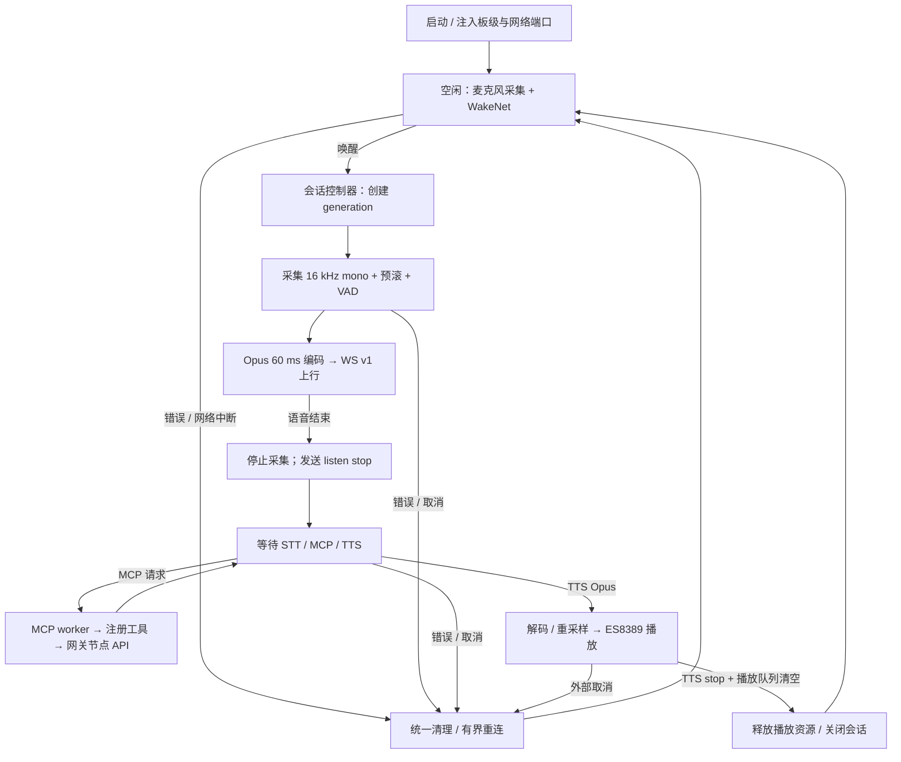

# 可移植语音链路架构（设计稿）

## 定位

借鉴 `ls_chat` 的公开 API / 连接 / 会话分层，不引入其专有云端实现。第一版继续兼容现有网关的小智 WebSocket v1 + Opus + JSON-RPC MCP。会话控制、音频和工具执行属于本仓库的 `voice_core`；云端连接、鉴权和协议适配将放在独立的 `listen_clouds` 仓库（https://github.com/wusezhiren/listen_clouds），由应用通过公共端口组合。该远端当前为空仓库，接口与依赖版本在实现时固定。

## 依赖方向与建议目录

```text
gateway_s31/main/
  app_main.c             初始化、组合依赖、启动/停止；不处理音频帧
  board/                 S31 BSP：ES8389、双麦、功放、SD、GT911（板级端口）
  adapters/              Wi-Fi/NVS、ESP-NOW 节点服务、UI 与工具执行回调
components/voice_core/
  include/voice_core/    对应用公开的语音会话、事件、端口与 MCP 注册接口
  core/                  会话状态机、取消/打断、队列调度、VAD 与音频帧路由
  codecs/                Opus 编/解码、流式重采样（与设备无关）
  mcp/                   JSON-RPC 校验、工具注册/派发、响应编码
  ports/esp_idf/         FreeRTOS、esp-sr、esp_codec_dev 的适配
  tests/                 状态转换、协议样例、MCP 正反例与资源释放
listen_clouds/ (独立仓库，作为组件依赖)
  include/               连接、会话消息、鉴权、音频帧收发接口
  protocols/xiaozhi_v1/  hello、listen、STT/TTS/MCP 信封与 raw Opus 帧
  ports/esp_idf/         TLS WebSocket、HTTP 激活与 NVS 凭据端口
  tests/                 协议样例、网络错误和重连测试
```

目录是模块落位方案，不提前创建空目录；组件可拆为若干 IDF component，公开头文件不能 `#include` BSP、`gw_api.h`、`meshproto.h` 或 `esp_websocket_client.h`。跨平台的协议、状态机、VAD 与 MCP 分发仅使用 C 类型和显式注入的操作接口；FreeRTOS 与 IDF 依赖留在 `ports/esp_idf/`。将来其他 RTOS/平台只实现端口，不改核心协议与工具定义。

## 模块契约

| 模块 | 输入 / 输出 | 不承担的职责 |
| --- | --- | --- |
| `voice_session` | `start/cancel/stop` 命令；`wake/stt/tts/error/closed` 事件；单调递增 session generation | Wi-Fi、GPIO、codec 句柄 |
| `voice_audio_port` | 打开/关闭 16 kHz mono PCM 捕获；按明确采样率播放 PCM；可选同时录放能力 | 云协议、VAD、MCP |
| `voice_wake` | PCM → 唤醒事件与预滚 PCM；模型路径由应用配置 | 网络请求 |
| `voice_codec` | 16 kHz mono PCM ↔ 60 ms Opus 帧；24 kHz TTS Opus → PCM → 播放采样率 | I2S 分配、WebSocket |
| `listen_clouds` transport | TLS WebSocket 连接与有界收发；完整 text/binary 消息回调 | 操作节点或 I2S |
| `listen_clouds` protocol/auth | v1 hello/listen/TTS/STT/MCP 信封与 raw Opus 包的解析/序列化；激活和凭据 | 本地唤醒与设备控制 |
| `voice_mcp` | `initialize`、`tools/list`、`tools/call`；注册 schema 与 execute 回调 | 直接访问 `gw_api` 或 ESP-NOW |
| 应用适配器 | NVS 凭据、网络状态、节点列表/设置、日志与 UI 提示 | 重写核心状态机 |

公开接口草案（签名在实现阶段收敛）：`voice_create(config, ports, event_cb)`、`voice_start()`、`voice_trigger()`、`voice_cancel()`、`voice_destroy()`；`mcp_register(name, schema, execute, context)`。`voice_audio_port` 提供独占打开/关闭及 capture/play 接口，返回能力（双工、支持的采样率）。回调报告事件，不从回调中同步等待自身任务。

MCP `execute` 输入是校验过的参数，输出是结构化结果或错误；JSON-RPC 层负责 `id` 原样回显与错误码。现有工具名及 schema 保持 `gateway.nodes.list`、`gateway.node.set`：执行层调用现有网关节点 API，SET 明确返回“已接收、等待节点上报”，不能把发送成功解释成继电器已动作。未来新增工具只注册新 handler，不修改云协议或音频代码。工具执行在独立工作任务，设置超时和结果大小上限，网络事件回调不得直接执行设备操作。

## FreeRTOS 运行模型

### 模式与实施顺序

- `SIMPLEX`（第一阶段）：录音与播放互斥。空闲时采集供唤醒；唤醒后录音、VAD 判停、发送音频，随后停止采集并播放 TTS；播放结束才恢复采集。播放期间不做声学唤醒/打断，可通过外部取消命令停止播放。网络接收与控制任务仍可并行，不等于音频全双工。
- `FULL_DUPLEX`（后续阶段）：录音与播放可同时运行；播放时保持唤醒检测，支持打断、旧会话取消和音频交接。仅在 S31 音频端口证明同时录放稳定、回声误唤醒可控后启用。
- 模式是 `voice_create` 的配置与音频端口能力校验项；核心会话/协议/MCP 不分叉。若端口不支持同时录放，请求 `FULL_DUPLEX` 必须显式报错，不能静默退回。

### 单工流程（首期）



单工状态转移：`IDLE → LISTENING → WAITING_REPLY → PLAYING → IDLE`；`CANCELLING` 可从任一活动状态进入并执行幂等清理。TTS 数据可在等待回复时进入有界队列，但必须先确认录音端口已关闭才能开始扬声器写入。MCP worker 与网络任务并行，不能阻塞播放或网络事件回调。

### 全双工增量（后续）


全双工不属于首期单工验收条件；先验证单轮录音→云端→MCP→回复和连续多轮无资源泄漏，再单独验收播放期打断。

```text
audio_capture task ──固定 PCM 块──> wake/VAD/session task ──帧──> opus_tx task
                                             │                    │
                                             │                    ▼
                                             │               network task (WS)
                                             │                    │
                                             │              bounded event queue
                                             │                 ┌──┴──┐
                                             ▼                 ▼     ▼
                                      session controller  mcp worker  tts_decode/play task
```

- `session controller` 唯一拥有会话状态、generation 和取消顺序；事件通过队列串行化。网络事件只复制有界数据并入队，不做 I2S 写入、Opus 编码或节点控制。
- PCM 与 Opus 使用预分配、有界队列及固定块；队列满明确计数并结束当前会话，避免默默丢失命令。实时采集不能等待网络。编码/网络发送与录音不同任务，持有缓冲区的所有权由队列交接，释放路径唯一。
- 单工时取消只处理外部命令与错误恢复；全双工启用后，播放期唤醒优先于 TTS：新 generation 使旧结果失效，取消旧播放/会话并交接预滚音频。迟到的 WS/TTS/MCP 结果按 generation 丢弃，新会话至少采集 1 秒实时音频后才允许 VAD 静音判停。
- 同时录放仅在全双工模式由音频端口声明并管理 I2S 成对通道/codec 生命周期；核心不猜测 I2S 资源。关闭顺序：停止采集/播放 → 停止队列生产 → 等待消费者完成或超时 → 释放 codec/通道/缓冲；每条失败路径走同一清理逻辑。
- FreeRTOS 配置（任务栈、优先级、核亲和、队列深度）由端口与板级配置决定，先测量峰值与延迟再定数值；跨平台核心只依赖调度/锁/时钟的抽象。连接重试由 transport 处理，会话重试由 controller 决定，避免重复重连。

## 协议与移植验收

- v1 hello 声明 16 kHz、mono、60 ms Opus 和 MCP；上行每个 Opus 帧是单独 raw binary WS 消息，下行 TTS 的 24 kHz Opus 格式由协议适配器明确处理。对服务端的 `hello/stt/tts/mcp` 消息使用固定样例做解析与往返测试，连接断开与半帧消息有明确错误路径。
- 音频端口先在 S31 上通过录音/回放及持续双工检查，再验 Opus、云端单轮、唤醒、多轮打断；对照旧 Korvo 的功能和日志，不把核心的可移植性建立在 S31 特有功能上。
- 主机端以 fake audio/transport/clock/tool executor 验证取消竞态、队列背压、迟到结果、MCP 参数正反例和连续资源释放；板上测试确认真实声学、TLS、耗时、内存水位与音质。
- 若未来换 `ls_chat` 或其他云端，只增加 `voice_protocol`/transport 适配，保留 session、audio、MCP 工具接口；如服务端不支持 MCP，需要显式能力协商，不能假设云端工具调用格式通用。

## 与现有代码的迁移对应

| 现有位置 | 拟迁入 |
| --- | --- |
| `gateway/main/gw_voice_ws.c` 混合逻辑 | transport + xiaozhi_v1 + codec + session + mcp worker |
| `gateway/main/gw_wake.c` | wake 逻辑 + 板级 audio capture port |
| `gateway/main/gw_voice_tools.c` | 通用 MCP JSON-RPC + `gateway_s31` 节点工具适配 |
| `gateway/main/voice_vad.*`、`voice_session.*`、`tts_resample.*` | core/codecs，经现有主机测试保护 |

v1 上行报文编码及主机测试已迁入 `listen_clouds`；TLS/WebSocket、鉴权和下行解析仍在 Korvo 网关，须继续迁移并分别验证。保留已有 Korvo 网关作为回归基准，按 [PLAN.md](PLAN.md) 的阶段逐个接入。
